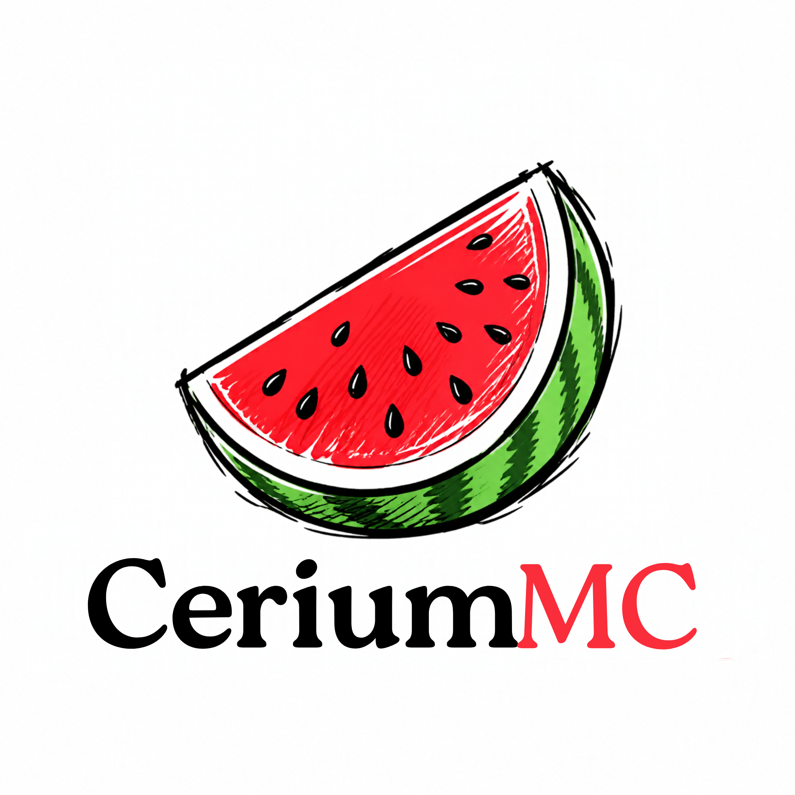

<p align="center">
  
</p>

<p align="center">
  <a href="https://github.com/StepByte-Studious/CeriumMC/actions/workflows/ci.yml"></a>
</p>

CeriumMC is a Minecraft: Java Edition server written from scratch in Rust. It aims to behave exactly like the vanilla server while using far fewer resources.

> **Status:** early development. Nothing is playable yet. Progress is tracked in [Roadmap.md](Roadmap.md).

## Goals

- **Vanilla parity.** Same packets, same world generation, same game mechanics as vanilla **26.3** (protocol 777).
- **Runs on modest hardware.** 20–30 players in under 1 GB of RAM.
- **Fast startup.** Near-instant boot.
- **Runs anywhere.** x86_64, ARM64 and 32-bit ARM, including a Raspberry Pi or an Android phone. It adapts to a single core or many, and to SSD, HDD or SD-card storage.
- **Compact worlds.** A custom storage format, planned after parity, aiming for 80–90% smaller worlds than Anvil.
- **Plugin API.** Planned after parity.

## Clean-room development

CeriumMC is written from the ground up. We study how vanilla *behaves* and never copy or translate Mojang's code. See [CONTRIBUTING.md](CONTRIBUTING.md) for the rules.

## Building

CI builds and tests every commit on Linux, Windows, macOS, ARM64, Raspberry Pi (armv7) and Android.

To build locally you need Rust 1.85 or newer, Java 25, Bash, `curl`, `jq` and `unzip`. Some tables are generated at build time from vanilla's own data generator, and those files are never committed. So download and verify the vanilla jar and generate the reports first:

```sh
bash scripts/fetch-vanilla.sh
bash scripts/gen-reports.sh
cargo build --release
```

The server binary is `target/release/ceriummc`.

## License

Licensed under either of

- Apache License, Version 2.0 ([LICENSE-APACHE](LICENSE-APACHE))
- MIT license ([LICENSE-MIT](LICENSE-MIT))

at your option.

Unless you explicitly state otherwise, any contribution intentionally submitted for inclusion in the work by you, as defined in the Apache-2.0 license, shall be dual licensed as above, without any additional terms or conditions.

CeriumMC is not an official Minecraft product and is not approved by or associated with Mojang or Microsoft.
